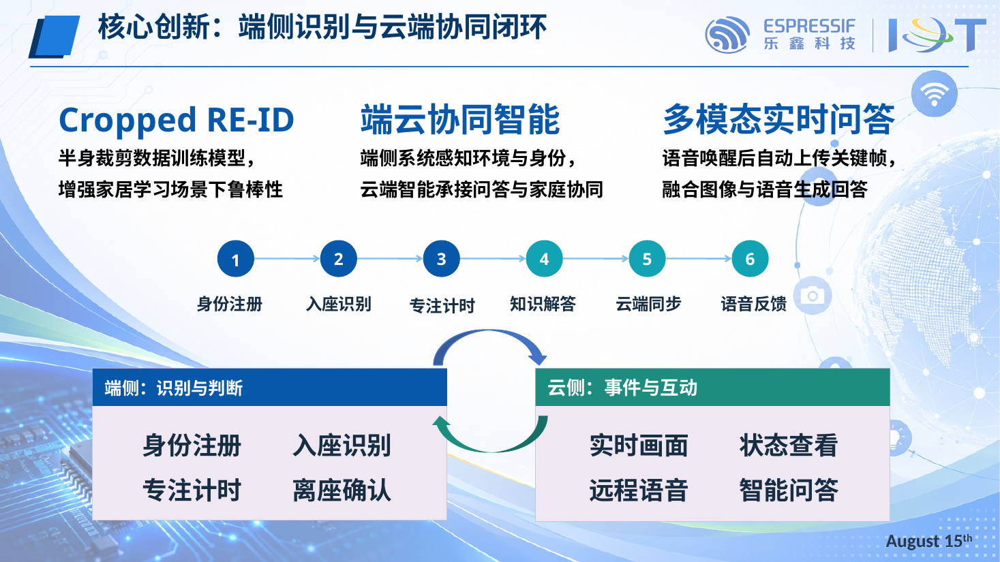
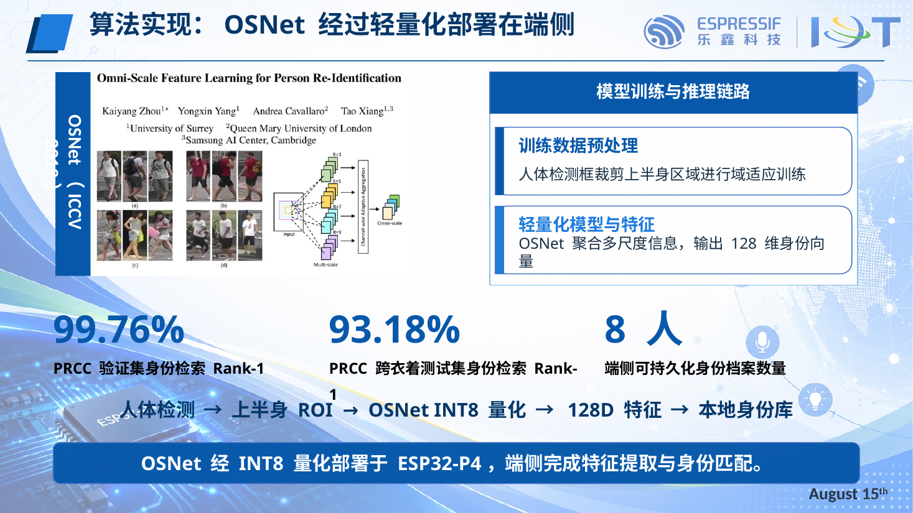
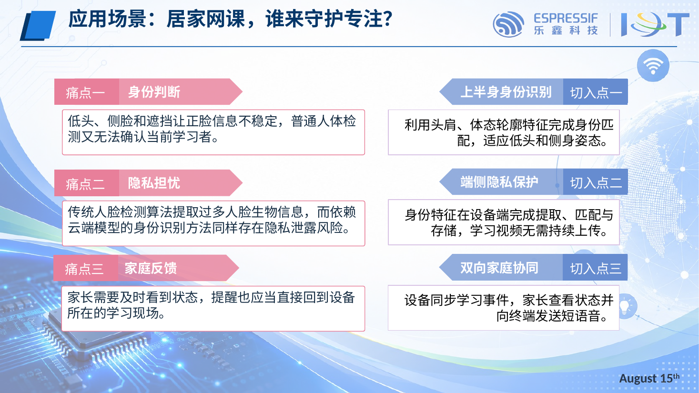
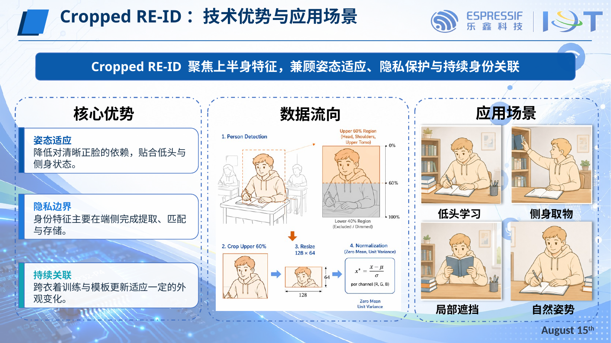
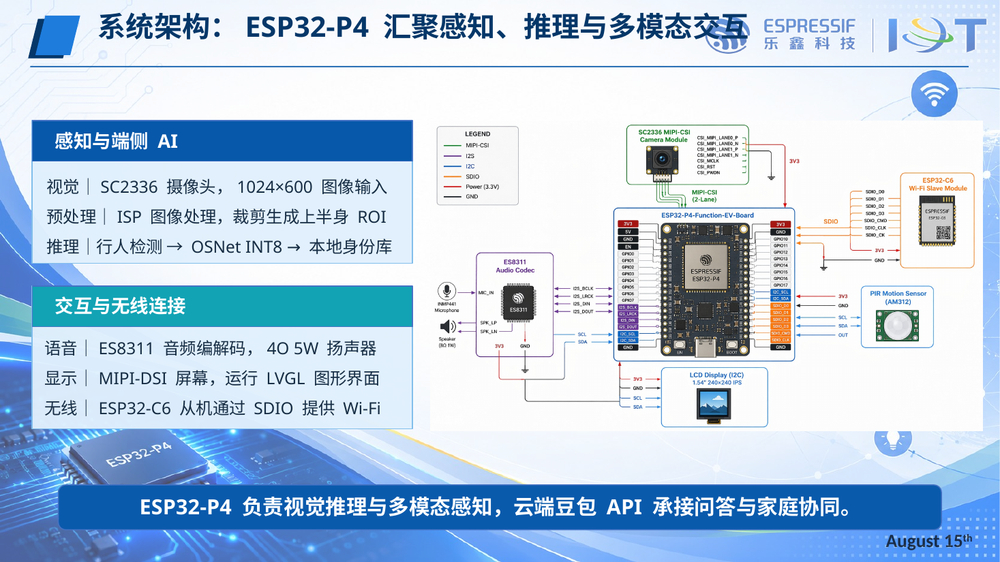
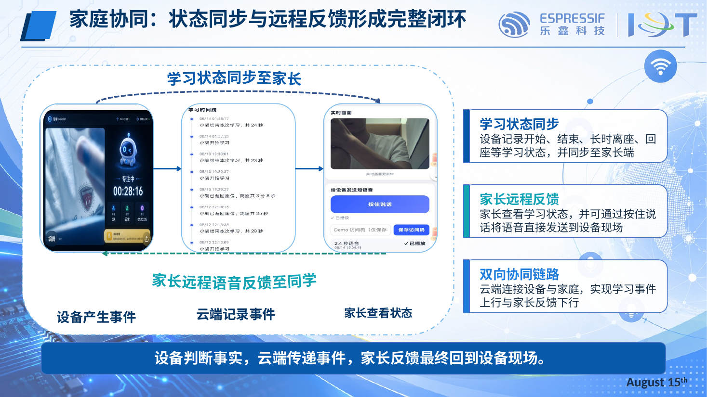

# 智学 Guardian：基于 ESP32-P4 的流视频多模态助学终端

> 2026 年全国大学生物联网设计竞赛 · 乐鑫赛道参赛作品 —— **华北赛区一等奖**
> 参赛队伍：C 组 9 号 ｜ 南开大学 ｜ 2026 年 8 月

基于 **ESP32-P4-Function-EV-Board** 的多模态 AIoT 助学终端：端侧完成**上半身裁剪行人重识别（Cropped Re-ID）**实现身份识别与专注计时，接入**云端豆包大模型 API**（VLM / ASR / TTS）实现知识问答，并通过**家长端 Web 平台**实现远程监督与双向语音反馈。

## 核心亮点

- **Cropped Re-ID 端侧身份识别**：针对居家学习场景"低头、侧脸、遮挡"导致正脸信息不稳定的问题，采用上半身裁剪数据训练行人重识别模型，身份特征在设备端完成提取、匹配与存储，学习视频无需持续上传，兼顾姿态适应与隐私保护；
- **端云协同闭环**：端侧负责感知与判断（身份注册、入座识别、专注计时、离座确认），云端承接事件同步与互动（实时画面、状态查看、远程语音、智能问答），家长反馈最终回到设备现场；
- **多模态实时问答**：语音唤醒后自动提取关键帧上传，融合图像与语音生成回答，屏幕显示 + 语音播报双通道输出。



## 效果指标

| 指标 | 数值 |
| --- | --- |
| PRCC 验证集身份检索 Rank-1 | **99.76%** |
| PRCC 跨衣着测试集身份检索 Rank-1 | **93.18%** |
| 端侧可持久化身份档案数量 | **8 人** |

推理链路：人体检测 → 上半身 ROI（Upper 60%）→ OSNet INT8 量化 → 128D 特征 → 本地身份库。



## 应用场景与痛点



| 痛点 | 我们的切入点 |
| --- | --- |
| 低头、侧脸和遮挡让正脸信息不稳定，普通人体检测无法确认当前学习者 | 利用头肩、体态轮廓特征完成身份匹配，适应低头和侧身姿态 |
| 传统人脸算法提取过多生物信息，云端身份识别存在隐私泄露风险 | 身份特征在设备端提取、匹配与存储，视频无需持续上传 |
| 家长需要及时看到状态，提醒应直接回到设备所在的学习现场 | 设备同步学习事件，家长查看状态并可向终端发送短语音 |



## 系统架构

ESP32-P4 负责视觉推理与多模态感知，云端豆包 API 承接问答与家庭协同。

- **感知与端侧 AI**：SC2336 摄像头（1024×600 图像输入）→ ISP 图像处理、裁剪生成上半身 ROI → 行人检测 → OSNet INT8 → 本地身份库
- **交互与无线连接**：ES8311 音频编解码 + 4Ω 5W 扬声器；MIPI-DSI 屏幕运行 LVGL 图形界面；ESP32-C6 从机通过 SDIO 提供 Wi-Fi
- **全局状态机**：IDLE / LISTENING / CAPTURING / ASKING / SPEAKING / MONITORING / ALERT，统一管理问答、监控、人走灯灭等多任务切换与资源互斥



## 家庭协同：状态同步与远程反馈闭环

设备判断事实 → 云端传递事件 → 家长查看状态 → 远程语音反馈至同学，形成完整闭环。



## 仓库结构

```
├── main/                    # 固件主程序（ESP-IDF）
├── components/              # 功能组件
│   ├── hci/                 # 人机交互引擎（唤醒/ASR/关键帧/VLM/TTS 链路）
│   ├── keyframe/            # 关键帧提取（清晰度 + 帧差）
│   ├── cloud_api/           # 云端 API 封装（VLM/ASR/TTS）
│   ├── monitor/             # PIR 环境监控
│   ├── human_detect/        # ESP-WHO 人体检测（人走灯灭）
│   ├── led_controller/      # LED 控制
│   ├── state_machine/       # 全局状态机
│   └── ui/                  # LVGL v9 屏幕 UI
├── training/osnet_reid/     # 上半身 Re-ID 云端训练代码（OSNet-IBN-x0.25，PRCC 数据集）
├── TEAM_DIVISION.md         # 团队分工与模块接口约定
└── docs/                    # 设计文档与展示图片
```

## 算法实现细节（Cropped Re-ID）

训练代码见 [`training/osnet_reid/`](training/osnet_reid)，基于 OSNet-IBN-x0.25 在 PRCC 上半身数据上微调：

- **损失组合**：L = L_id + L_triplet + 0.0005·L_center + 0.5·L_consistency
  - `L_id`：Softmax 身份分类
  - `L_triplet`：Batch Hard Triplet，强制跨衣服正样本
  - `L_center`：Center Loss，增强类内紧凑
  - `L_consistency`：同一人不同衣服的余弦相似度约束（换装一致性，margin 0.6）
- **训练策略**：三阶段解冻（冻结 conv1/conv2 只训上层 → 解冻 conv2 → 全解冻 + 早停）
- **部署链路**：PyTorch → ONNX 导出 → INT8 TFLite 量化 → ESP32-P4 TFLite Micro 端侧推理（输入 128×64，输出 128 维特征）

## 快速开始

**Re-ID 模型训练与导出**（PC 端）：

```bash
cd training/osnet_reid
pip install -r requirements.txt
python train.py --config config.yaml --device cuda   # PRCC 数据放入 data/prcc
python export_onnx.py --checkpoint outputs/best_model.pth \
    --output outputs/osnet_upperbody.onnx --input_h 128 --input_w 64 --verify
python tools/convert_tflite_int8.py --onnx outputs/osnet_upperbody.onnx \
    --output outputs/osnet_upperbody_int8.tflite --calib_data data/prcc/rgb/val
```

**固件构建与烧录**（ESP-IDF 环境，Windows PowerShell）：

```powershell
.\build.ps1    # 构建主固件
.\flash.ps1    # 烧录并监视串口日志
```

## 团队

| 成员 | 分工 |
| --- | --- |
| 胡博涵 | 队长：整体方案设计；上半身行人重识别完整实现；语言 + 视觉大模型 API 接入 |
| 黄国天、王宣贺 | 终端系统集成、UI 与家庭协同平台开发 |

指导教师：李涛、董前琨（南开大学）

## 致谢

感谢乐鑫科技（Espressif）提供的 ESP32-P4-Function-EV-Board 开发平台与技术支持。
